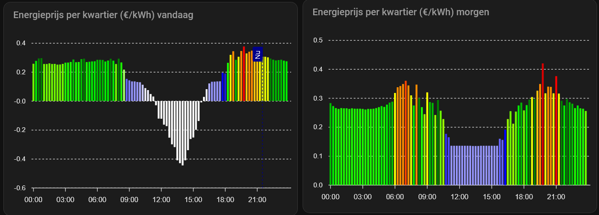

[](https://github.com/HiDiHo01/home-assistant-frank_energie/releases/)

[](https://buymeacoffee.com/royarx)
[](https://www.paypal.me/royarx)

**Langue :** [English](README.md) | [Nederlands](README.nl.md) | [Français](README.fr.md)

# Intégration Frank Energie pour Home Assistant
Cette intégration permet de consulter les prix de l'énergie proposés par Frank Energie dans Home Assistant.

Vous pouvez, par exemple, utiliser les capteurs de prix pour automatiser des appareils en fonction du prix actuel de l'énergie.

## Documentation

- [Index de la documentation](docs/index.md) - Vue d'ensemble de la documentation disponible.

### Documentation utilisateur

- [Configuration](docs/configuration.md) - Installation, authentification, sélection du site et paramètres.
- [Diagnostics](docs/diagnostics.md) - Recueillir des diagnostics, activer les journaux de débogage et signaler un problème.
- [Entités](docs/entities.md) - Présentation des plateformes d'entités et de leurs fonctionnalités.
- [Événements](docs/events.md) - Événements Home Assistant émis par l'intégration.
- [Exemples](docs/examples.md) - Automatisations, notifications et idées de tableaux de bord.
- [Questions fréquentes](docs/faq.md) - Réponses aux questions courantes.
- [Batterie intelligente](docs/smart_battery.md) - Fonctionnalités, modes et configuration de Smart Battery.
- [Recharge intelligente](docs/smart_charging.md) - Fonctionnalités et dépannage de Smart Charging.
- [Chauffage intelligent](docs/smart_hvac_activation.md) - Capteur d'activation « Slim verwarmen », disponibilité et prérequis.
- [Dépannage](docs/troubleshooting.md) - Problèmes courants et comportement attendu.
- [Fréquence d'actualisation](docs/update_frequency.md) - Intervalles de mise à jour, plages de maintenance et publication des prix.
- [Fonctionnalités utilisateur](docs/user_features.md) - Vue d'ensemble des fonctionnalités Frank Energie prises en charge.

### Documentation pour les contributeurs

- [Architecture](docs/architecture.md) - Structure de l'intégration, coordinateurs et circulation des données.
- [Guide de développement](docs/developer.md) - Normes de développement, tests et contributions.
- [Processus de publication](docs/release_process.md) - Gestion des versions, automatisation des publications et HACS.

### Assistant ChatGPT Frank Energie

- [Assistant ChatGPT Frank Energie](https://chatgpt.com/g/g-6a30a8e006b081919967c4c79fd542d7-frank-energie-assistant)

# Services

L'intégration Frank Energie n'enregistre actuellement aucun service Home Assistant.

Ses fonctionnalités sont accessibles à l'aide des entités, événements, boutons, listes de sélection et capteurs.

## Installation
Copiez le dossier `frank_energie` situé dans `custom_components` de ce dépôt vers le dossier `custom_components` de votre installation Home Assistant.

### HACS
[](https://github.com/hacs/integration)

Dans HACS, ajoutez ce dépôt en tant que [dépôt personnalisé](https://hacs.xyz/docs/faq/custom_repositories), dans la catégorie « Intégration ».

### Configuration

<a href="https://my.home-assistant.io/redirect/config_flow_start/?domain=frank_energie" class="my badge" target="_blank">
    
</a>

Ajoutez l'intégration Frank Energie depuis **Paramètres → Appareils et services → Ajouter une intégration**.
Vous pouvez ensuite désactiver ou masquer individuellement les capteurs.

#### Attention

Si vous utilisiez déjà cette intégration avec `configuration.yaml`, supprimez l'ancienne configuration, puis configurez à nouveau Frank Energie via l'assistant décrit ci-dessus.

#### Connexion

Lors de la configuration, vous pouvez vous connecter avec votre compte Frank Energie. La connexion n'est pas nécessaire pour obtenir les prix publics, mais elle permet d'accéder aux données liées à votre compte. Après connexion, des capteurs peuvent notamment afficher les coûts de consommation prévisionnels et réels du mois en cours, lorsque ces données sont disponibles via l'API.

### Utilisation

Certains capteurs disposent d'un attribut `prices` contenant les prix connus. Vous pouvez utiliser un modèle Home Assistant pour créer vos propres capteurs à partir de ces données.

Exemple : prix connu le plus élevé après l'heure actuelle :
```
{{ state_attr('sensor.current_electricity_price_all_in', 'prices') | selectattr('from', 'gt', now()) | max(attribute='price') }}
```

Prix le plus bas aujourd'hui :
```
{{ state_attr('sensor.current_electricity_price_all_in', 'prices') | selectattr('till', 'le', now().replace(hour=23)) | min(attribute='price') }}
```

Prix le plus bas au cours des six prochaines heures :
```
{{ state_attr('sensor.current_electricity_price_all_in', 'prices') | selectattr('from', 'gt', now()) | selectattr('till', 'lt', now() + timedelta(hours=6)) | min(attribute='price') }}
```

### Graphiques (exemples)
La [carte ApexCharts](https://github.com/RomRider/apexcharts-card) permet d'afficher les prix futurs de l'énergie :

#### Exemple 1 – Toutes les données


```yaml 
type: custom:apexcharts-card
graph_span: 48h
span:
  start: day
now:
  show: true
  label: Maintenant
  color: darkblue
header:
  show: true
  title: Prix de l'énergie (€/kWh) sur 48 heures
  show_states: false
  colorize_states: true
series:
  - entity: sensor.frank_energie_stroomprijzen_huidige_elektriciteitsprijs_all_in
    name: Prix
    show:
      legend_value: false
    stroke_width: 0
    float_precision: 3
    type: column
    opacity: 1
    color: "#44739e"
    color_threshold:
      - value: 0
        color: "#4473ff"
      - value: 0.19
        color: "#4473cf"
      - value: 0.2
        color: "#99ff00"
      - value: 0.25
        color: "#6fff00"
      - value: 0.26
        color: "#1aff00"
      - value: 0.27
        color: "#00ee00"
      - value: 0.28
        color: "#00bb00"
      - value: 0.29
        color: green
      - value: 0.3
        color: "#eaff00"
      - value: 0.31
        color: "#ffff00"
      - value: 0.32
        color: "#ffc40c"
      - value: 0.33
        color: darkorange
      - value: 0.35
        color: orangered
      - value: 0.375
        color: "#ff0000"
      - value: 0.4
        color: "#df0000"
      - value: 0.425
        color: "#af0000"
      - value: 0.45
        color: darkred
    data_generator: |
      return entity.attributes.prices.map((record, index) => {
        return [record.from, record.price];
      });
experimental:
  color_threshold: true
apex_config:
  chart:
    height: 300px
    animations:
      enabled: true
      easing: easeinout
      speed: 2000
      animateGradually:
        enabled: true
        delay: 500
```

#### Exemple 2 – Les 10 prochaines heures


```yaml
type: custom:apexcharts-card
graph_span: 14h
span:
  start: hour
  offset: '-3h'
now:
  show: true
  label: Maintenant
  color: darkblue
header:
  show: true
  title: Prix de l'énergie (€/kWh) sur 10 heures
  show_states: false
  colorize_states: true
series:
  - entity: sensor.frank_energie_stroomprijzen_huidige_elektriciteitsprijs_all_in
    name: Prix
    show:
      legend_value: false
    stroke_width: 0
    float_precision: 3
    type: column
    opacity: 1
    color: "#44739e"
    color_threshold:
      - value: 0
        color: "#4473ff"
      - value: 0.19
        color: "#4473cf"
      - value: 0.2
        color: "#99ff00"
      - value: 0.25
        color: "#6fff00"
      - value: 0.26
        color: "#1aff00"
      - value: 0.27
        color: "#00ee00"
      - value: 0.28
        color: "#00bb00"
      - value: 0.29
        color: green
      - value: 0.3
        color: "#eaff00"
      - value: 0.31
        color: "#ffff00"
      - value: 0.32
        color: "#ffc40c"
      - value: 0.33
        color: darkorange
      - value: 0.35
        color: orangered
      - value: 0.375
        color: "#ff0000"
      - value: 0.4
        color: "#df0000"
      - value: 0.425
        color: "#af0000"
      - value: 0.45
        color: darkred
    data_generator: |
      return entity.attributes.prices.map((record, index) => {
        return [record.from, record.price];
      });
experimental:
  color_threshold: true
apex_config:
  chart:
    height: 300px
    animations:
      enabled: true
      easing: easeinout
      speed: 2000
      animateGradually:
        enabled: true
        delay: 500
```
#### Exemple 3 – Aujourd'hui et demain (affichage conditionnel)



```
type: custom:apexcharts-card
graph_span: 24h
span:
  start: day
now:
  show: true
  label: Maintenant
  color: darkblue
header:
  show: true
  title: Prix de l'énergie par quart d'heure (€/kWh) aujourd'hui
series:
  - entity: sensor.frank_energie_stroomprijzen_gemiddelde_elektriciteitsprijs_vandaag_all_in
    name: Prix
    stroke_width: 0
    float_precision: 3
    type: column
    opacity: 1
    color: "#44739e"
    color_threshold:
      - value: 0
        color: rgb(255,255,255)
      - value: 0.05
        color: rgb(240,240,255)
      - value: 0.1
        color: rgb(225,225,255)
      - value: 0.11
        color: rgb(200,200,255)
      - value: 0.12
        color: rgb(175,175,255)
      - value: 0.13
        color: rgb(150,150,255)
      - value: 0.14
        color: rgb(125,125,255)
      - value: 0.15
        color: rgb(100,100,255)
      - value: 0.16
        color: rgb(75,75,255)
      - value: 0.17
        color: rgb(50,50,255)
      - value: 0.18
        color: rgb(25,25,225)
      - value: 0.19
        color: rgb(0,0,255)
      - value: 0.2
        color: "#aaff66"
      - value: 0.22
        color: "#99ff00"
      - value: 0.25
        color: "#6fff00"
      - value: 0.26
        color: "#1aff00"
      - value: 0.27
        color: "#00ee00"
      - value: 0.28
        color: "#00bb00"
      - value: 0.29
        color: green
      - value: 0.3
        color: "#eaff00"
      - value: 0.31
        color: "#ffff00"
      - value: 0.32
        color: "#ffc40c"
      - value: 0.33
        color: darkorange
      - value: 0.35
        color: orangered
      - value: 0.375
        color: "#ff0000"
      - value: 0.4
        color: "#df0000"
      - value: 0.425
        color: "#af0000"
      - value: 0.45
        color: darkred
    data_generator: |
      return entity.attributes.prices.map((record, index) => {
        return [record.from, record.price];
      });
experimental:
  color_threshold: true
```

```
type: conditional
conditions:
  - condition: state
    entity: sensor.frank_energie_stroomprijzen_gemiddelde_elektriciteitsprijs_morgen_all_in
    state_not: unavailable
card:
  type: custom:apexcharts-card
  graph_span: 24h
  span:
    start: day
    offset: +24h
  header:
    show: true
    title: Prix de l'énergie par quart d'heure (€/kWh) demain
  series:
    - entity: >-
        sensor.frank_energie_stroomprijzen_gemiddelde_elektriciteitsprijs_morgen_all_in
      name: Prix
      stroke_width: 0
      float_precision: 3
      type: column
      opacity: 1
      color: "#44739e"
      color_threshold:
        - value: 0
          color: rgb(255,255,255)
        - value: 0.05
          color: rgb(240,240,255)
        - value: 0.1
          color: rgb(225,225,255)
        - value: 0.11
          color: rgb(200,200,255)
        - value: 0.12
          color: rgb(175,175,255)
        - value: 0.13
          color: rgb(150,150,255)
        - value: 0.14
          color: rgb(125,125,255)
        - value: 0.15
          color: rgb(100,100,255)
        - value: 0.16
          color: rgb(75,75,255)
        - value: 0.17
          color: rgb(50,50,255)
        - value: 0.18
          color: rgb(25,25,225)
        - value: 0.19
          color: rgb(0,0,255)
        - value: 0.2
          color: "#99ff00"
        - value: 0.25
          color: "#6fff00"
        - value: 0.26
          color: "#1aff00"
        - value: 0.27
          color: "#00ee00"
        - value: 0.28
          color: "#00bb00"
        - value: 0.29
          color: green
        - value: 0.3
          color: "#eaff00"
        - value: 0.31
          color: "#ffff00"
        - value: 0.32
          color: "#ffc40c"
        - value: 0.33
          color: darkorange
        - value: 0.35
          color: orangered
        - value: 0.375
          color: "#ff0000"
        - value: 0.4
          color: "#df0000"
        - value: 0.425
          color: "#af0000"
        - value: 0.45
          color: darkred
      data_generator: |
        const tomorrowPrices = entity.attributes.tomorrow_prices;
        return tomorrowPrices
          ? tomorrowPrices.map((record, index) => [record.from, record.price])
        : [0];
  experimental:
    color_threshold: true
```

#### Exemple 4 – Coûts mensuels de cette année


```
type: custom:apexcharts-card
graph_span: 11month
span:
  start: year
header:
  show: true
  title: Coûts mensuels de cette année
now:
  show: true
  color: darkblue
  label: Maintenant
series:
  - entity: sensor.frank_energie_kosten_kosten_dit_jaar
    name: Coût
    stroke_width: 0
    float_precision: 2
    show:
      header_color_threshold: false
      extremas: true
    type: column
    opacity: 0.7
    color: "#44739e"
    color_threshold:
      - value: 0
        color: rgb(67,255,71)
      - value: 10
        color: rgb(67,220,71)
      - value: 20
        color: rgb(67,190,71)
      - value: 30
        color: rgb(67,160,71)
      - value: 40
        color: rgb(67,130,71)
      - value: 50
        color: rgb(67,100,71)
      - value: 60
        color: darkorange
      - value: 80
        color: orangered
      - value: 100
        color: red
      - value: 125
        color: darkred
    data_generator: >
      const Invoices = entity.attributes.Invoices;

      if (typeof Invoices !== 'object' || Invoices === null) {
        console.error('Invoices attribute is not an object:', Invoices);
        return [0];
      }

      //console.log('Invoices:', Invoices);
      // Transform the object into an array of objects

      const invoicesArray = Object.entries(Invoices).map(([periodDescription,
      data]) => ({
        period_description: data['Period description'],
        start_date: data['Start date'],
        total_amount: data['Total amount'] || 0
      }));

      //console.log('Invoices Array:', invoicesArray);

      const data = invoicesArray.map((record) => [record.start_date, 
      record.total_amount, record.period_description]);

      //console.log('Data:', data);

      return data;
experimental:
  color_threshold: true
```

#### Exemple 5 – Coûts mensuels de l'année précédente


```
type: custom:apexcharts-card
graph_span: 11months
span:
  start: year
  offset: "-12months"
header:
  show: true
  title: Coûts mensuels de l'année précédente
series:
  - entity: sensor.frank_energie_kosten_kosten_vorig_jaar
    name: Coût
    stroke_width: 0
    float_precision: 2
    show:
      header_color_threshold: false
      extremas: true
    type: column
    opacity: 0.7
    color: "#44739e"
    color_threshold:
      - value: 0
        color: "#44739e"
      - value: 20
        color: green
      - value: 40
        color: darkgreen
      - value: 60
        color: darkorange
      - value: 80
        color: orangered
      - value: 100
        color: darkred
    data_generator: >
      const Invoices = entity.attributes.Invoices;

      if (typeof Invoices !== 'object' || Invoices === null) {
        console.error('Invoices attribute is not an object:', Invoices);
        return [0];
      }

      //console.log('Invoices:', Invoices);
      // Transform the object into an array of objects

      const invoicesArray = Object.entries(Invoices).map(([periodDescription,
      data]) => ({
        period_description: data['Period description'],
        start_date: data['Start date'],
        total_amount: data['Total amount'] || 0
      }));

      //console.log('Invoices Array:', invoicesArray);

      const data = invoicesArray.map((record) => [record.start_date, 
      record.total_amount, record.period_description]);

      //console.log('Data:', data);

      return data;
experimental:
  color_threshold: true

```

#### Exemple 6 – Prix le plus bas et le plus élevé aujourd'hui


```
type: markdown
content: >-
  <h1><ha-alert title="Frank Energie"></h1><h2>Aujourd'hui, le prix de l'électricité
  par kWh

  est le plus bas entre
  {{as_timestamp(state_attr('sensor.frank_energie_stroomprijzen_laagste_elektriciteitsprijs_vandaag_all_in',
  'from_time'))|timestamp_custom(' %H:%M')|replace(" 0", "")}} en
  {{(as_timestamp(state_attr('sensor.frank_energie_stroomprijzen_laagste_elektriciteitsprijs_vandaag_all_in',
  'till_time')))|timestamp_custom(' %H:%M')|replace(" 0", "")}} (€
  {{states('sensor.frank_energie_stroomprijzen_laagste_elektriciteitsprijs_vandaag_all_in')|round(3)}})
  et

  est le plus haut entre
  {{as_timestamp(state_attr('sensor.frank_energie_stroomprijzen_hoogste_elektriciteitsprijs_vandaag_all_in',
  'from_time'))|timestamp_custom(' %H:%M')|replace(" 0", "")}} en
  {{(as_timestamp(state_attr('sensor.frank_energie_stroomprijzen_hoogste_elektriciteitsprijs_vandaag_all_in',
  'till_time')))|timestamp_custom(' %H:%M')|replace(" 0", "")}} (€
  {{states('sensor.frank_energie_stroomprijzen_hoogste_elektriciteitsprijs_vandaag_all_in')|round(3)}}).

  </h2></ha-alert>
```
