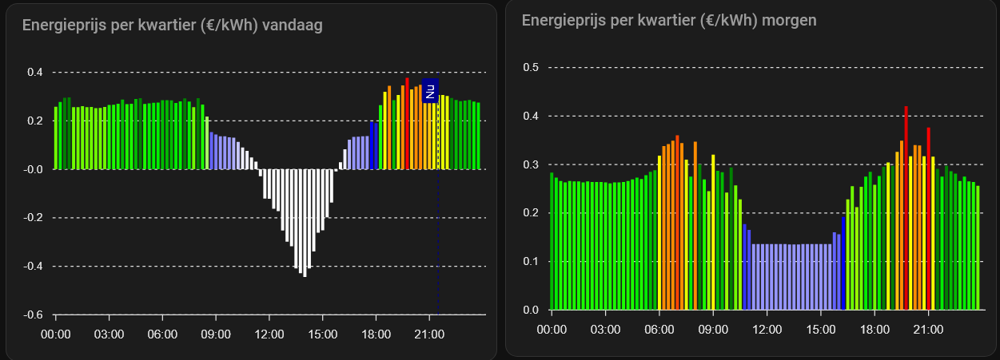

[](https://github.com/HiDiHo01/home-assistant-frank_energie/releases/)

[](https://buymeacoffee.com/royarx)
[](https://www.paypal.me/royarx)

**Taal:** [English](README.md) | [Nederlands](README.nl.md) | [Français](README.fr.md)

# Frank Energie-integratie voor Home Assistant
Deze integratie maakt de actuele prijsinformatie van Frank Energie beschikbaar in Home Assistant.

Je kunt de prijssensoren bijvoorbeeld gebruiken om apparaten automatisch in of uit te schakelen op basis van de actuele energieprijs.

## Documentatie

- [Documentatieoverzicht](docs/index.md) - Overzicht van de beschikbare documentatie.

### Gebruikersdocumentatie

- [Configuratie](docs/configuration.md) - Installatie, aanmelden, locatiekeuze en instellingen.
- [Diagnostiek](docs/diagnostics.md) - Diagnostische gegevens verzamelen, debuglogging inschakelen en problemen melden.
- [Entiteiten](docs/entities.md) - Overzicht van alle entiteitsplatforms en functies.
- [Gebeurtenissen](docs/events.md) - Home Assistant-gebeurtenissen van de Frank Energie-integratie.
- [Voorbeelden](docs/examples.md) - Automatiseringen, meldingen en dashboardideeën.
- [Veelgestelde vragen](docs/faq.md) - Antwoorden op veelvoorkomende vragen en situaties.
- [Slimme batterij](docs/smart_battery.md) - Functies, modi en configuratie van Smart Battery.
- [Slim laden](docs/smart_charging.md) - Functies en probleemoplossing voor Smart Charging.
- [Slim verwarmen](docs/smart_hvac_activation.md) - Activeringssensor, beschikbaarheid en vereiste afhankelijkheden.
- [Probleemoplossing](docs/troubleshooting.md) - Veelvoorkomende problemen en verwacht gedrag.
- [Verversfrequentie](docs/update_frequency.md) - Verversintervallen, onderhoudsvensters en publicatietijden van prijzen.
- [Gebruikersfuncties](docs/user_features.md) - Overzicht van ondersteunde Frank Energie-functies.

### Documentatie voor ontwikkelaars

- [Architectuur](docs/architecture.md) - Opbouw van de integratie, coördinatoren en gegevensstromen.
- [Ontwikkelaarshandleiding](docs/developer.md) - Ontwikkelstandaarden, tests en richtlijnen voor bijdragen.
- [Releaseproces](docs/release_process.md) - Versiebeheer, releaseworkflow en publicatie via HACS.

### ChatGPT Frank Energie-assistent

- [ChatGPT Frank Energie-assistent](https://chatgpt.com/g/g-6a30a8e006b081919967c4c79fd542d7-frank-energie-assistant)

# Services

De Frank Energie-integratie registreert momenteel geen Home Assistant-services.

De beschikbare functies worden aangeboden via entiteiten, gebeurtenissen, knoppen, keuzelijsten en sensoren.

## Installatie
Kopieer de map `frank_energie` uit `custom_components` in deze repository naar de map `custom_components` van je Home Assistant-installatie.

### HACS
[](https://github.com/hacs/integration)

Je kunt deze repository in HACS toevoegen als [aangepaste repository](https://hacs.xyz/docs/faq/custom_repositories), met de categorie 'Integratie'.

### Configuratie

<a href="https://my.home-assistant.io/redirect/config_flow_start/?domain=frank_energie" class="my badge" target="_blank">
    
</a>

Voeg de Frank Energie-integratie toe via **Instellingen → Apparaten en diensten → Integratie toevoegen**.
Je kunt individuele sensoren vervolgens uitschakelen of verbergen.

#### Let op

Heb je Frank Energie eerder via `configuration.yaml` ingesteld? Verwijder dan de oude configuratie en stel de integratie opnieuw in via de configuratiestroom hierboven.

#### Aanmelden

Tijdens het instellen kun je je aanmelden met je Frank Energie-account. Aanmelden is niet vereist voor openbare prijsinformatie, maar geeft toegang tot accountgebonden gegevens. Na aanmelden zijn onder meer sensoren voor de verwachte en daadwerkelijke kosten in de huidige maand beschikbaar, voor zover de API die gegevens aanbiedt.

### Gebruik

Sommige sensoren hebben een attribuut `prices` met de bekende prijzen. Met een Home Assistant-template kun je hiervan eigen sensoren maken.

Voorbeeld: de hoogste bekende prijs na het huidige uur:
```
{{ state_attr('sensor.current_electricity_price_all_in', 'prices') | selectattr('from', 'gt', now()) | max(attribute='price') }}
```

Laagste prijs vandaag:
```
{{ state_attr('sensor.current_electricity_price_all_in', 'prices') | selectattr('till', 'le', now().replace(hour=23)) | min(attribute='price') }}
```

Laagste prijs in de komende zes uur:
```
{{ state_attr('sensor.current_electricity_price_all_in', 'prices') | selectattr('from', 'gt', now()) | selectattr('till', 'lt', now() + timedelta(hours=6)) | min(attribute='price') }}
```

### Grafieken (voorbeelden)
Met de [ApexCharts-kaart](https://github.com/RomRider/apexcharts-card) kun je toekomstige energieprijzen weergeven:

#### Voorbeeld 1 – Alle gegevens


```yaml 
type: custom:apexcharts-card
graph_span: 48h
span:
  start: day
now:
  show: true
  label: Nu
  color: darkblue
header:
  show: true
  title: Energieprijs (€/kWh) voor 48 uur
  show_states: false
  colorize_states: true
series:
  - entity: sensor.frank_energie_stroomprijzen_huidige_elektriciteitsprijs_all_in
    name: Prijs
    show:
      legend_value: false
    stroke_width: 0
    float_precision: 3
    type: column
    opacity: 1
    color: "#44739e"
    color_threshold:
      - value: 0
        color: "#4473ff"
      - value: 0.19
        color: "#4473cf"
      - value: 0.2
        color: "#99ff00"
      - value: 0.25
        color: "#6fff00"
      - value: 0.26
        color: "#1aff00"
      - value: 0.27
        color: "#00ee00"
      - value: 0.28
        color: "#00bb00"
      - value: 0.29
        color: green
      - value: 0.3
        color: "#eaff00"
      - value: 0.31
        color: "#ffff00"
      - value: 0.32
        color: "#ffc40c"
      - value: 0.33
        color: darkorange
      - value: 0.35
        color: orangered
      - value: 0.375
        color: "#ff0000"
      - value: 0.4
        color: "#df0000"
      - value: 0.425
        color: "#af0000"
      - value: 0.45
        color: darkred
    data_generator: |
      return entity.attributes.prices.map((record, index) => {
        return [record.from, record.price];
      });
experimental:
  color_threshold: true
apex_config:
  chart:
    height: 300px
    animations:
      enabled: true
      easing: easeinout
      speed: 2000
      animateGradually:
        enabled: true
        delay: 500
```

#### Voorbeeld 2 – Komende 10 uur


```yaml
type: custom:apexcharts-card
graph_span: 14h
span:
  start: hour
  offset: '-3h'
now:
  show: true
  label: Nu
  color: darkblue
header:
  show: true
  title: Energieprijs (€/kWh) voor 10 uur
  show_states: false
  colorize_states: true
series:
  - entity: sensor.frank_energie_stroomprijzen_huidige_elektriciteitsprijs_all_in
    name: Prijs
    show:
      legend_value: false
    stroke_width: 0
    float_precision: 3
    type: column
    opacity: 1
    color: "#44739e"
    color_threshold:
      - value: 0
        color: "#4473ff"
      - value: 0.19
        color: "#4473cf"
      - value: 0.2
        color: "#99ff00"
      - value: 0.25
        color: "#6fff00"
      - value: 0.26
        color: "#1aff00"
      - value: 0.27
        color: "#00ee00"
      - value: 0.28
        color: "#00bb00"
      - value: 0.29
        color: green
      - value: 0.3
        color: "#eaff00"
      - value: 0.31
        color: "#ffff00"
      - value: 0.32
        color: "#ffc40c"
      - value: 0.33
        color: darkorange
      - value: 0.35
        color: orangered
      - value: 0.375
        color: "#ff0000"
      - value: 0.4
        color: "#df0000"
      - value: 0.425
        color: "#af0000"
      - value: 0.45
        color: darkred
    data_generator: |
      return entity.attributes.prices.map((record, index) => {
        return [record.from, record.price];
      });
experimental:
  color_threshold: true
apex_config:
  chart:
    height: 300px
    animations:
      enabled: true
      easing: easeinout
      speed: 2000
      animateGradually:
        enabled: true
        delay: 500
```
#### Voorbeeld 3 – Vandaag en morgen (voorwaardelijk)



```
type: custom:apexcharts-card
graph_span: 24h
span:
  start: day
now:
  show: true
  label: Nu
  color: darkblue
header:
  show: true
  title: Energieprijs per kwartier (€/kWh) vandaag
series:
  - entity: sensor.frank_energie_stroomprijzen_gemiddelde_elektriciteitsprijs_vandaag_all_in
    name: Prijs
    stroke_width: 0
    float_precision: 3
    type: column
    opacity: 1
    color: "#44739e"
    color_threshold:
      - value: 0
        color: rgb(255,255,255)
      - value: 0.05
        color: rgb(240,240,255)
      - value: 0.1
        color: rgb(225,225,255)
      - value: 0.11
        color: rgb(200,200,255)
      - value: 0.12
        color: rgb(175,175,255)
      - value: 0.13
        color: rgb(150,150,255)
      - value: 0.14
        color: rgb(125,125,255)
      - value: 0.15
        color: rgb(100,100,255)
      - value: 0.16
        color: rgb(75,75,255)
      - value: 0.17
        color: rgb(50,50,255)
      - value: 0.18
        color: rgb(25,25,225)
      - value: 0.19
        color: rgb(0,0,255)
      - value: 0.2
        color: "#aaff66"
      - value: 0.22
        color: "#99ff00"
      - value: 0.25
        color: "#6fff00"
      - value: 0.26
        color: "#1aff00"
      - value: 0.27
        color: "#00ee00"
      - value: 0.28
        color: "#00bb00"
      - value: 0.29
        color: green
      - value: 0.3
        color: "#eaff00"
      - value: 0.31
        color: "#ffff00"
      - value: 0.32
        color: "#ffc40c"
      - value: 0.33
        color: darkorange
      - value: 0.35
        color: orangered
      - value: 0.375
        color: "#ff0000"
      - value: 0.4
        color: "#df0000"
      - value: 0.425
        color: "#af0000"
      - value: 0.45
        color: darkred
    data_generator: |
      return entity.attributes.prices.map((record, index) => {
        return [record.from, record.price];
      });
experimental:
  color_threshold: true
```

```
type: conditional
conditions:
  - condition: state
    entity: sensor.frank_energie_stroomprijzen_gemiddelde_elektriciteitsprijs_morgen_all_in
    state_not: unavailable
card:
  type: custom:apexcharts-card
  graph_span: 24h
  span:
    start: day
    offset: +24h
  header:
    show: true
    title: Energieprijs per kwartier (€/kWh) morgen
  series:
    - entity: >-
        sensor.frank_energie_stroomprijzen_gemiddelde_elektriciteitsprijs_morgen_all_in
      name: Prijs
      stroke_width: 0
      float_precision: 3
      type: column
      opacity: 1
      color: "#44739e"
      color_threshold:
        - value: 0
          color: rgb(255,255,255)
        - value: 0.05
          color: rgb(240,240,255)
        - value: 0.1
          color: rgb(225,225,255)
        - value: 0.11
          color: rgb(200,200,255)
        - value: 0.12
          color: rgb(175,175,255)
        - value: 0.13
          color: rgb(150,150,255)
        - value: 0.14
          color: rgb(125,125,255)
        - value: 0.15
          color: rgb(100,100,255)
        - value: 0.16
          color: rgb(75,75,255)
        - value: 0.17
          color: rgb(50,50,255)
        - value: 0.18
          color: rgb(25,25,225)
        - value: 0.19
          color: rgb(0,0,255)
        - value: 0.2
          color: "#99ff00"
        - value: 0.25
          color: "#6fff00"
        - value: 0.26
          color: "#1aff00"
        - value: 0.27
          color: "#00ee00"
        - value: 0.28
          color: "#00bb00"
        - value: 0.29
          color: green
        - value: 0.3
          color: "#eaff00"
        - value: 0.31
          color: "#ffff00"
        - value: 0.32
          color: "#ffc40c"
        - value: 0.33
          color: darkorange
        - value: 0.35
          color: orangered
        - value: 0.375
          color: "#ff0000"
        - value: 0.4
          color: "#df0000"
        - value: 0.425
          color: "#af0000"
        - value: 0.45
          color: darkred
      data_generator: |
        const tomorrowPrices = entity.attributes.tomorrow_prices;
        return tomorrowPrices
          ? tomorrowPrices.map((record, index) => [record.from, record.price])
        : [0];
  experimental:
    color_threshold: true
```

#### Voorbeeld 4 – Maandkosten dit jaar


```
type: custom:apexcharts-card
graph_span: 11month
span:
  start: year
header:
  show: true
  title: Kosten per maand dit jaar
now:
  show: true
  color: darkblue
  label: Nu
series:
  - entity: sensor.frank_energie_kosten_kosten_dit_jaar
    name: Kosten
    stroke_width: 0
    float_precision: 2
    show:
      header_color_threshold: false
      extremas: true
    type: column
    opacity: 0.7
    color: "#44739e"
    color_threshold:
      - value: 0
        color: rgb(67,255,71)
      - value: 10
        color: rgb(67,220,71)
      - value: 20
        color: rgb(67,190,71)
      - value: 30
        color: rgb(67,160,71)
      - value: 40
        color: rgb(67,130,71)
      - value: 50
        color: rgb(67,100,71)
      - value: 60
        color: darkorange
      - value: 80
        color: orangered
      - value: 100
        color: red
      - value: 125
        color: darkred
    data_generator: >
      const Invoices = entity.attributes.Invoices;

      if (typeof Invoices !== 'object' || Invoices === null) {
        console.error('Invoices attribute is not an object:', Invoices);
        return [0];
      }

      //console.log('Invoices:', Invoices);
      // Transform the object into an array of objects

      const invoicesArray = Object.entries(Invoices).map(([periodDescription,
      data]) => ({
        period_description: data['Period description'],
        start_date: data['Start date'],
        total_amount: data['Total amount'] || 0
      }));

      //console.log('Invoices Array:', invoicesArray);

      const data = invoicesArray.map((record) => [record.start_date, 
      record.total_amount, record.period_description]);

      //console.log('Data:', data);

      return data;
experimental:
  color_threshold: true
```

#### Voorbeeld 5 – Maandkosten vorig jaar


```
type: custom:apexcharts-card
graph_span: 11months
span:
  start: year
  offset: "-12months"
header:
  show: true
  title: Kosten per maand vorig jaar
series:
  - entity: sensor.frank_energie_kosten_kosten_vorig_jaar
    name: Kosten
    stroke_width: 0
    float_precision: 2
    show:
      header_color_threshold: false
      extremas: true
    type: column
    opacity: 0.7
    color: "#44739e"
    color_threshold:
      - value: 0
        color: "#44739e"
      - value: 20
        color: green
      - value: 40
        color: darkgreen
      - value: 60
        color: darkorange
      - value: 80
        color: orangered
      - value: 100
        color: darkred
    data_generator: >
      const Invoices = entity.attributes.Invoices;

      if (typeof Invoices !== 'object' || Invoices === null) {
        console.error('Invoices attribute is not an object:', Invoices);
        return [0];
      }

      //console.log('Invoices:', Invoices);
      // Transform the object into an array of objects

      const invoicesArray = Object.entries(Invoices).map(([periodDescription,
      data]) => ({
        period_description: data['Period description'],
        start_date: data['Start date'],
        total_amount: data['Total amount'] || 0
      }));

      //console.log('Invoices Array:', invoicesArray);

      const data = invoicesArray.map((record) => [record.start_date, 
      record.total_amount, record.period_description]);

      //console.log('Data:', data);

      return data;
experimental:
  color_threshold: true

```

#### Voorbeeld 6 – Laagste en hoogste prijs vandaag


```
type: markdown
content: >-
  <h1><ha-alert title="Frank Energie"></h1><h2>Vandaag is de prijs van stroom
  per kWh

  het laagst tussen
  {{as_timestamp(state_attr('sensor.frank_energie_stroomprijzen_laagste_elektriciteitsprijs_vandaag_all_in',
  'from_time'))|timestamp_custom(' %H:%M')|replace(" 0", "")}} en
  {{(as_timestamp(state_attr('sensor.frank_energie_stroomprijzen_laagste_elektriciteitsprijs_vandaag_all_in',
  'till_time')))|timestamp_custom(' %H:%M')|replace(" 0", "")}} (€
  {{states('sensor.frank_energie_stroomprijzen_laagste_elektriciteitsprijs_vandaag_all_in')|round(3)}})
  en

  het hoogst tussen
  {{as_timestamp(state_attr('sensor.frank_energie_stroomprijzen_hoogste_elektriciteitsprijs_vandaag_all_in',
  'from_time'))|timestamp_custom(' %H:%M')|replace(" 0", "")}} en
  {{(as_timestamp(state_attr('sensor.frank_energie_stroomprijzen_hoogste_elektriciteitsprijs_vandaag_all_in',
  'till_time')))|timestamp_custom(' %H:%M')|replace(" 0", "")}} (€
  {{states('sensor.frank_energie_stroomprijzen_hoogste_elektriciteitsprijs_vandaag_all_in')|round(3)}}).

  </h2></ha-alert>
```
